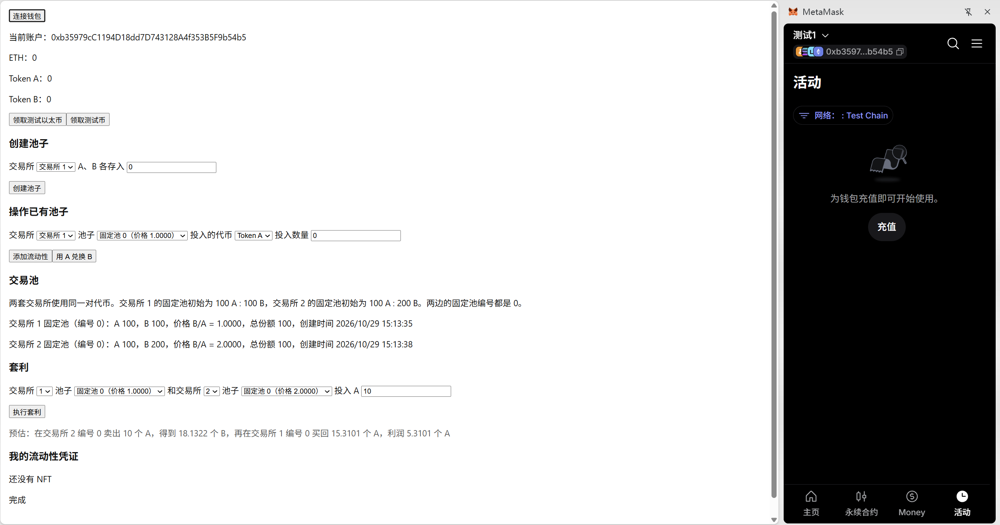
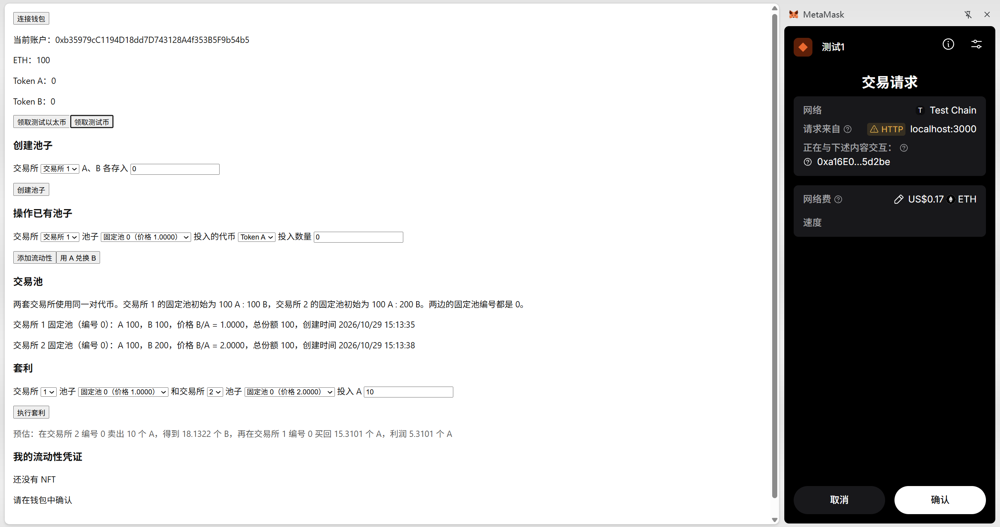
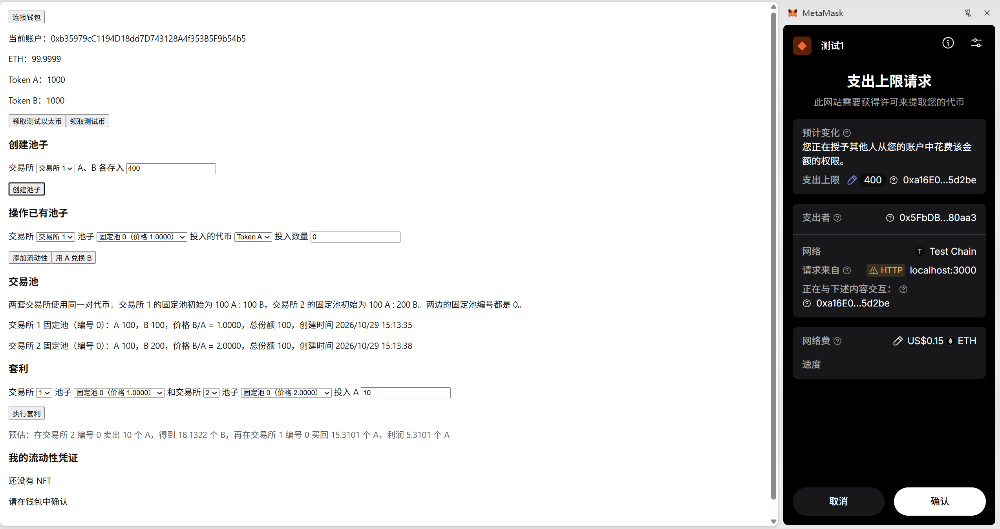
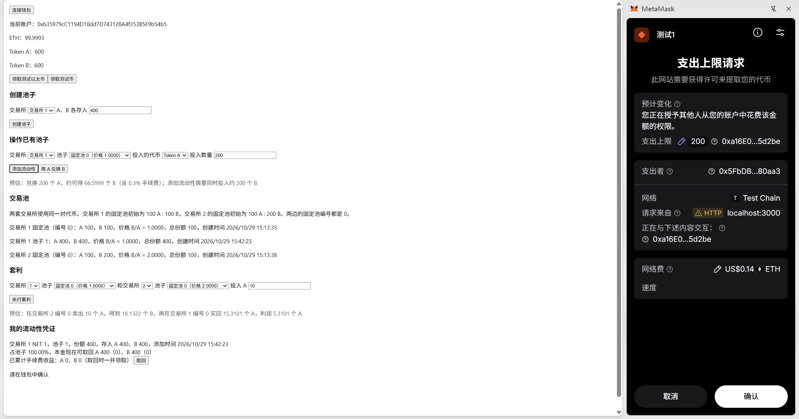
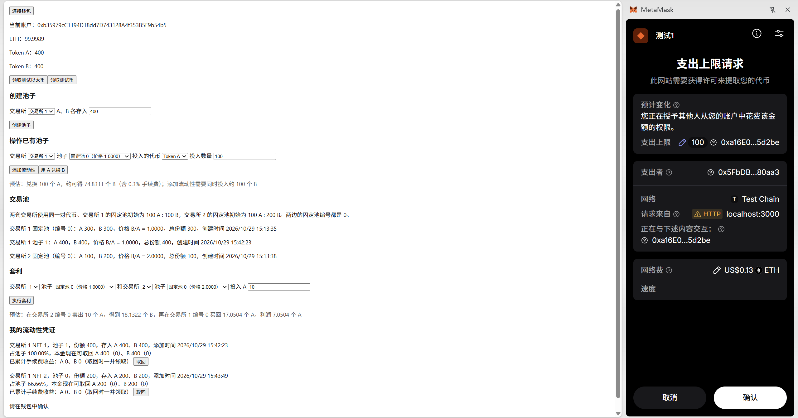
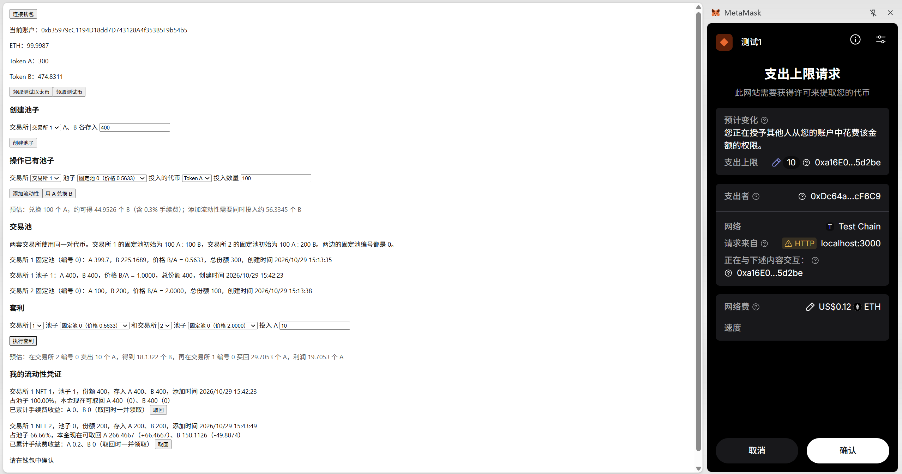
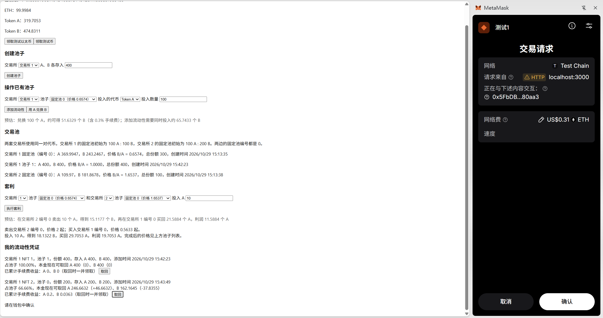
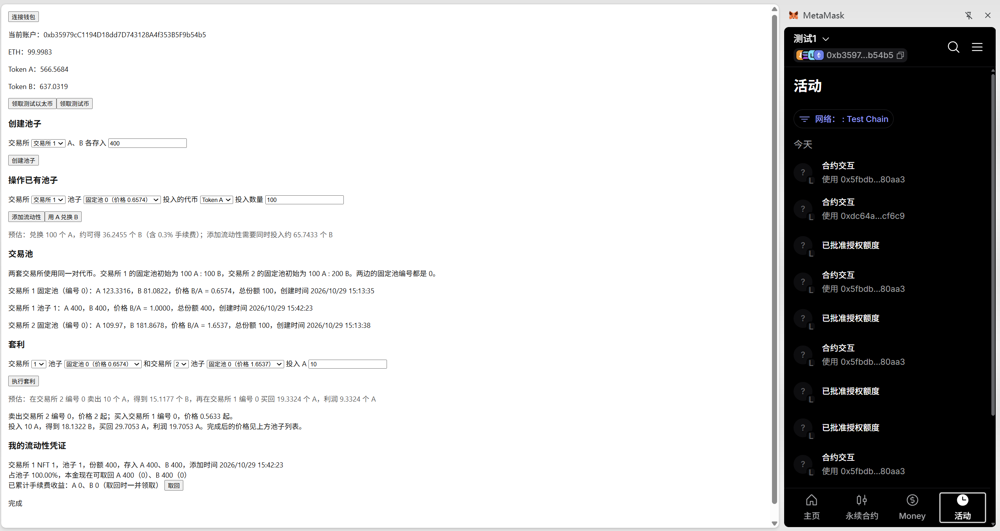

# MiniDEX：双交易所与原子套利

## 如何运行

本地测试链使用 Hardhat 节点，不需要 Ganache。节点地址是 `http://127.0.0.1:8545`，链 ID 是 `1337`。

1. 在 `contracts` 目录安装依赖并编译：

    ```bash
    cd contracts
    npm install
    npm run compile
    ```

2. 启动本机节点，并保持这个终端开着：

    ```bash
    npm run node
    ```

    终端里会打印 20 个测试账户和私钥。部署合约时脚本会使用其中的第一个账户，不需要把这些私钥导入 MetaMask。

3. 另开一个终端，在 `contracts` 目录部署合约：

    ```bash
    npm run deploy
    ```

    部署完成后会打印两套交易所和 `Arbitrage` 的地址。新节点上的地址是：交易所 1 `0x5FbDB2315678afecb367f032d93F642f64180aa3`，交易所 2 `0xe7f1725E7734CE288F8367e1Bb143E90bb3F0512`，套利合约 `0xDc64a140Aa3E981100a9becA4E685f962f0cF6C9`。给交易所 2 铸币和建立固定池各占一笔交易，所以套利合约不是第三个合约地址。它们与 `frontend/src/App.tsx` 里的 `DEX1_ADDRESS`、`DEX2_ADDRESS`、`ARB_ADDRESS` 一致。如果打印出来的地址不同，把页面里的常量改成该地址后再打开页面。

4. 在 `frontend` 目录安装依赖并启动页面：

    ```bash
    cd frontend
    npm install
    npm run start
    ```

    浏览器打开 `http://localhost:3000`。在 MetaMask 中新建一个账户，并添加网络：RPC 填 `http://127.0.0.1:8545`，链 ID 填 `1337`，货币符号填 `ETH`。连接钱包后，先点「领取测试以太币」给这个新账户加上 100 ETH，再点「领取测试币」。新账户初始没有余额，不导入节点私钥也可以操作。

5. 模拟 20 个用户随机交易，并在交易后做一次原子套利时，在 `contracts` 目录执行：

    ```bash
    npm run simulate
    ```

    这个命令使用 Hardhat 的内置网络，不依赖第 2 步已经启动的节点，结果也不会出现在网页上。

## 功能实现分析

本项目是一个基于恒定乘积的去中心化交易所。合约为 `MiniDEX`，测试代币为 `MyERC20`，页面通过 MetaMask 连接本地链。

1. **两种测试代币。** `MiniDEX` 的构造函数部署 Token A（TKA）和 Token B（TKB）。用户在页面点击【领取测试币】后，合约调用 `airdrop()`，每种代币铸造 500 个给当前地址。用户点击「领取测试以太币」后，页面向本地节点调用 hardhat_setBalance，给当前账户增加 100 ETH，用来支付后续交易的 gas。这笔 ETH 不进入交易池。

2. **交易池和定价。** 用户在页面输入数量并授权后，调用 `createPool()`。合约把两种代币转入池子，用 `reserveA`、`reserveB` 记录储备。兑换使用恒定乘积：先从投入数量中扣除 0.3% 手续费，再用 `储备 × 净投入 / (储备 + 净投入)` 计算换出数量。手续费不进入储备，单独按流动性份额记账，避免把手续费算进价格。

3. **添加和撤销流动性。** 添加时用户指定其中一种代币的数量，另一种按当前储备比例计算，调用 `addLiquidity()`。合约按存入数量占总储备的比例发放份额，并铸造一张 ERC721 凭证。凭证记录池子编号、份额、存入数量和时间。撤销时调用 `removeLiquidity()`，按 `当前储备 × 份额 / 总份额` 退回两种代币，同时加上该凭证累计的手续费，然后销毁这张 NFT。因此别人兑换之后，取回的数量会偏离当初存入的数量。页面上的「本金现在可取回」和「已累计手续费」分别对应这两部分。

4. **模拟交易。** `contracts` 目录运行 `npm run simulate`。脚本使用 20 个地址，在两套交易所的固定池中随机兑换、添加和撤销流动性，共 80 次。结束后检查两套交易所持有的代币是否不少于储备加未领取手续费，并核对用户与合约的代币之和是否等于发行量。随机交易之后，脚本再调用套利合约，打印套利前后两边的储备、价格和利润，并演示同一池子套利会整笔回滚。

5. **两套交易所。** 部署两份 `MiniDEX`，共用 Token A 和 Token B。交易所 1 在构造时建立固定池，编号 0，初始 100 A : 100 B，价格 B/A 为 1。交易所 2 使用同一对代币，固定池编号也是 0，初始 100 A : 200 B，价格 B/A 为 2。底仓 NFT 归各自的合约所有，用户不能取走。用户在其中一边兑换，只改变那一套交易所的储备。页面按交易所分别列出池子，创建池子、添加流动性和兑换时要先选择交易所。

6. **原子套利。** `Arbitrage` 合约比较两个池子的价格 B/A，这两个池子可以属于不同交易所，也可以属于同一交易所。调用 `execute()` 时，它先在价格更高的池子把 A 换成 B，再在价格更低的池子把得到的 B 全部换回 A。两次 `exchange` 发生在同一笔交易里。换回的 A 不超过投入时，`require` 失败，两跳兑换和转账全部回滚。同一池子来回兑换只会损失两边 0.3% 手续费，因此也会回滚。页面默认比较交易所 1 和交易所 2 的固定池。「执行套利」成功后显示卖出和买入的交易所、交易前价格、中间得到的 B、买回的 A 和利润；交易后的价格在上方池子列表里刷新。

## 项目运行截图

连接钱包后，两套交易所的固定池已经在页面上，价格分别是 1 和 2。



领取测试以太币后余额为 100 ETH。右侧是 MetaMask 正在确认领取测试币。



向交易所 1 授权各 400 个代币，用来创建新池子。完成后，下一张图里出现池子 1，储备为 400 A 和 400 B。此时 Token A、Token B 已经各有 1000 个。



向交易所 1 的固定池添加流动性，投入 200 个 A。页面上已有一张流动性 NFT。



用 100 个 A 兑换 B。兑换之后，交易所 1 固定池的价格从 1 变为约 0.5633，见下一张图的池子列表。



授权套利合约使用 10 个 A。这一张还是授权弹窗，套利结果在下一张。



套利已经完成：在交易所 2 的固定池卖出 A，在交易所 1 的固定池买回 A，利润 19.7053 A。两边价格分别变为约 0.6574 和 1.6537。右侧是 MetaMask 确认取回流动性。



取回之后，交易所 1 固定池对应的 NFT 消失，代币回到账户。右侧活动记录里能看到与交易所和套利合约的交互。


